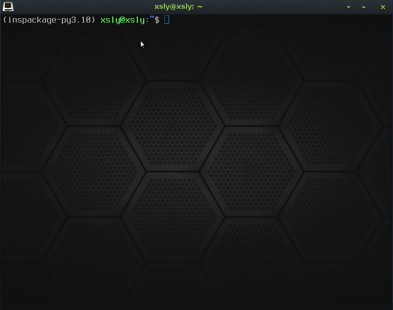

# 📦 Inspackage

[](https://badge.fury.io/py/inspackage)
[](https://pypi.org/project/inspackage/)
[](https://opensource.org/licenses/MIT)
[](https://github.com/psf/black)

**Inspackage** is a CLI tool designed to inspect Python packages with ease. It provides an interactive, hierarchical tree view of your project's structure, allowing you to dive deep into files to visualize classes, methods, variables, and properties directly from your terminal.

Built with [Typer](https://typer.tiangolo.com/) and [Textual](https://textual.textualize.io/).

---

## ✨ Features

- **🗂 Interactive Tree View**: Navigate through folders and files using a rich TUI (Text User Interface).
- **🔍 Deep Inspection**: Don't just stop at the file level. Inspect the *internals* of your Python files:
    - Classes & Constructors 
    - Methods & Properties
    - Global Variables & Constants
- **⚡ Fast & Lightweight**: optimized for quick navigation of large codebases.


## 🚀 Installation

You can install `inspackage` directly from PyPI:
```bash
pip install inspackage
```


## 💻 Usage
To inspect a package or directory, run the inspackage command followed by the target you want to analyze.

```bash
# Inspect the current directory
inspackage .

# Inspect a package installed on the current venv
inspackage <package-name>

# Inspect a specific package path (directory or a single .py file)
inspackage --dir /path/to/python/project
```


The default format (`tui`) is interactive, here you can
- Use the Arrow Keys to navigate the tree.
- Press `Enter` or `Space` to expand/collapse directories or file details.
- Press `Q` to quit or `D` to toggle display between dark/light mode.

### Output formats and files
```
inspackage [TARGET] [--dir PATH] [--format {tui,tree,json}] [-o FILE]
           [--include-private] [--exclude GLOB]... [--max-depth N] [-v]
```
```bash
# Static tree printed on the console
inspackage <package-name> --format tree

# JSON (with "schema_version") on stdout, or written to a file
inspackage <package-name> --format json
inspackage <package-name> --format json -o inspection.json

# Plain-text tree in a file (no colors)
inspackage . --format tree -o tree.txt

# Filters
inspackage . --include-private --exclude "tests" --exclude "*_pb2.py" --max-depth 2

# Resolved path, module/error counts (and tracebacks of unexpected errors) on stderr
inspackage . --format tree --verbose

# All options
inspackage --help
```
Without `-o`, text formats go to stdout. `-o` cannot be combined with `--format tui`. When `-o` is given without
`--format`, the format is inferred from the extension (`.json` -> json, `.txt` -> tree); any other extension is an
error (the default format is `tui`, which cannot be written to a file: pass `--format`). Files are written atomically
(a failed run never leaves a partial file). Closing the pipe early (`inspackage X --format json | head -1`) is not an
error. More formats (html, md, llm, graph) are planned and currently answer with a "not available in this version"
error.

### Customizing the TUI (`-e/--env`)
`-e/--env FILE` loads an env file (default `~/.inspackagerc`, optional) that sets the Textual themes:
```bash
# ~/.inspackagerc
LIGHT_THEME=textual-light
DARK_THEME=flexoki
```
Any Textual theme name works. Values from the file override the current environment.

### Deprecated options (still working)
| Old | Now | Notes |
| --- | --- | --- |
| `--static` | `--format tree` | prints a warning on stderr |
| `--save` | `--format json -o <name>.json` | `<name>` is the resolved package/module name (e.g. `xml.etree` -> `etree.json`), written to the current directory; combined with `--static`/`--format tree`/`tui` it is written in addition to that output, before the TUI opens. Alone, it no longer opens the TUI. Prints a warning on stderr |

### Exit codes
| Code | Meaning |
| --- | --- |
| 0 | success |
| 1 | invalid usage (name and `--dir` together, unknown option or format, `-o` with `tui`, unwritable output) |
| 2 | target not found, not a Python source, no Python modules found, or inspection failure |

Errors are short messages on stderr, without traceback (use `--verbose` to get it).

### Behavior changes (v0.2.0)
- `__init__.py` and `__main__.py` now appear in the tree.
- Names starting with `_` are hidden by default; use `--include-private` to show them.
- An installed package has priority over a local folder with the same name; use `./name` to force the folder.
- Directory symlinks are not followed.
- `--save` alone no longer opens the TUI; it only writes the JSON file. To keep the old behavior (save, then open the
  TUI) use `--format tui --save`.
- **The JSON written by `--save` / `--format json` changed format.** It is now the versioned schema
  (`schema_version`, `type`, `modules`, `packages`, ... plus new keys); the old `name`/`category`/`nodes` format of
  v0.1.x is no longer written. Tools reading old files must be updated.
- The `--save` file name uses the resolved name (e.g. `xml.etree` -> `etree.json`, `.` -> the directory name), never `.`.


<br>


## 🛠 Development
This project uses Poetry for dependency management and packaging.
```bash
# Clone the repository:
git clone [https://github.com/xslyr/inspackage.git](https://github.com/xslyr/inspackage.git)
cd inspackage

# Install dependencies:
poetry install
```

To Run locally use:
```bash
poetry run inspackage .
```

To run tasks, lint and ruff you can use pre-configured taskipy actions
```bash
task test
task lint
task ruff
```


## 🤝 Contributing
Contributions are welcome! Please feel free to submit a Pull Request.

Fork the project

Create your feature branch (git checkout -b feature/AmazingFeature)

Commit your changes (git commit -m 'Add some AmazingFeature')

Push to the branch (git push origin feature/AmazingFeature)

Open a Pull Request


## 📄 License
This project is licensed under the MIT License - see the [LICENSE](https://github.com/xslyr/inspackage/blob/main/LICENSE) file for details.